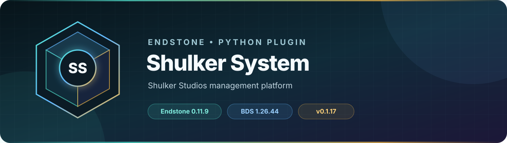

<!-- endstone-professional-header:start -->
<p align="center">
  
</p>

<p align="center">
  <a href="https://github.com/TheNINJALLO/endstone-shulker-system/actions/workflows/wheel-release.yml"></a>
  <a href="https://github.com/TheNINJALLO/endstone-shulker-system/releases/latest"></a>
</p>

<p align="center">
  
  
  
  =3.11" src="https://img.shields.io/badge/Python-%3E=3.11-3776AB?style=flat-square&amp;logo=python&amp;logoColor=white">
</p>

<p align="center">
  <strong>Shulker Studios management platform.</strong>
</p>

<p align="center">
  <a href="#what-it-does">What it does</a> &bull;
  <a href="#how-to-use">How to use</a> &bull;
  <a href="#commands-and-permissions">Commands</a> &bull;
  <a href="#install">Install</a> &bull;
  <a href="https://github.com/TheNINJALLO/endstone-shulker-system/releases">Releases</a>
</p>

## Overview

Shulker Studios management platform. This release is aligned with Endstone 0.11.9 and Minecraft Bedrock Dedicated Server 1.26.44, and is distributed as a Python wheel for direct installation in an Endstone server.

## What it does

- Scans addon content, manages deployment, and serves a Shulker Studios administration dashboard.
- Schedules and delivers player rewards through Script Events with persistent delivery tracking.
- Polls Tebex for purchases and turns approved packages into in-game deliveries.

## How to use

1. Start once, then review addon deployment targets, world selection, dashboard port, and development/production mode.
2. Store the Tebex secret only in the local runtime configuration and restrict dashboard port `9020` (or your configured port) at the firewall/reverse proxy.
3. Use the dashboard to scan/deploy content and test a delivery with a staging package.
4. Configure Tebex to execute `/shulkertebex <player> <package_name>` through the server console only.

## Commands and permissions

| Command / usage | What it does | Access |
|---|---|---|
| `/shulkertebex <player> <package_name>` | Handle Tebex donations and deliveries | Server console only |

## Compatibility

| Component | Supported version |
|---|---|
| Endstone | `0.11.9` |
| Endstone API | `0.11` |
| Bedrock Dedicated Server | `1.26.44` |
| Python | `>=3.11` |
| Plugin release | `v0.1.18` |

## Install

Download the wheel from the matching GitHub release:

```bash
gh release download v0.1.18 --repo TheNINJALLO/endstone-shulker-system --pattern "*.whl"
```

Copy the downloaded wheel into the server's `plugins/` directory, remove any older wheel for the same plugin, and restart Endstone.

> [!IMPORTANT]
> Use Endstone `0.11.9` with BDS `1.26.44`. Back up worlds and plugin data before upgrading a production server.

## Configuration and secrets

Runtime databases, logs, local `.env` files, server directories, and root `config.toml` files are excluded from source releases. When an example configuration is provided, copy it locally and keep live tokens, passwords, webhook URLs, and server identifiers out of Git.

## Release automation

Every `v*` tag runs [the wheel release workflow](.github/workflows/wheel-release.yml), builds the package in a clean GitHub runner, stores the wheel as a workflow artifact, and attaches it to the matching GitHub release.
<!-- endstone-professional-header:end -->
