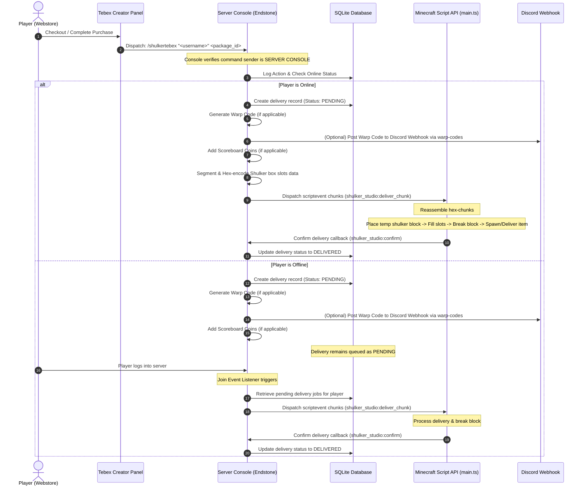

# Tebex Donation Integration & Fulfillment System Guide

This guide breaks down the architecture, security model, data flow, database schemas, package configurations, and setup steps for the Tebex integration in the `endstone-shulker-system` plugin.

---

## 1. System Architecture & Lifecycle

The Tebex integration is designed to bridge the webstore with in-game reward fulfillment. It supports immediate deliveries for online players and offline queueing for players who purchase while not in-game.

### Donation Lifecycle Flowchart



---

## 2. Security Model (Anti-Exploit)

To prevent players or operator-level staff from cheating the store, the `/shulkertebex` command implements **strict sender validation**:
- The command checks if the executor object matches `self.server.command_sender`.
- If a player, an in-game operator, or a command block attempts to run `/shulkertebex`, the command execution is halted immediately and prints:
  `This command can only be executed by the server console.`
- This console-only restriction ensures that packages can only be triggered via your store integration (e.g., a secure RCON connection or the Tebex plugin console dispatcher).

---

## 3. Minecraft Bedrock Script API Communication

Minecraft Bedrock Script API `scriptevent` command calls have a strict length limit of **2048 characters**. To deliver complex shulker inventories (which can contain 27 slots of enchanted books, name tags, lore, and custom metadata), our system utilizes a **Hex-chunked Segmented Delivery Protocol**:

1. **Serialization**: The Python backend JSON-serializes the shulker slots payload.
2. **Chunking**: The JSON string is divided into segments of 900 characters each.
3. **Hex Encoding**: Each segment is converted to its hex-string representation to prevent escape characters, quotes, or brackets from breaking the Minecraft command parser.
4. **Command Dispatch**: The backend executes multiple `scriptevent` commands in the format:
   `scriptevent shulker_studio:deliver_chunk <job_id>_<index>_<total>_<hex_data>`
5. **Reassembly**: The TypeScript Script Addon (`main.ts`) listens to `shulker_studio:deliver_chunk`, collects the segments, validates that all parts have arrived, decodes the hex strings back to UTF-8, parses the JSON payload, and begins the in-game delivery.
6. **Container Populating Fallback**: Because Minecraft Bedrock does not support modifying container items directly in a player's inventory, the script employs a safe **Place-and-Break** mechanism:
   - Finds a safe temporary air block coordinates near the player.
   - Saves the original block permutation.
   - Temporarily places a shulker block.
   - Fills its inventory with the items, enchantments, and lore.
   - Runs `/setblock <x> <y> <z> air destroy` to break it, causing it to drop as a filled item entity.
   - Instantly intercepts and picks up the dropped item entity, transferring it to the player's inventory.
   - Restores the original block at that location.
   - Sends confirmation via `scriptevent shulker_studio:confirm`.

---

## 4. SQLite Database Schema

Deliveries, templates, items, and staff actions are tracked in a local SQLite database (`shulker_studio.db`). The key tables are:

### `deliveries`
Stores each Tebex package delivery job status.
- `id` (INTEGER, Primary Key): Unique job ID.
- `player_name` (TEXT): Target player's in-game name.
- `template_name` (TEXT): Audit reference name of the kit.
- `shulker_type` (TEXT): The item type identifier (e.g., `minecraft:purple_shulker_box`).
- `slots_data` (TEXT): JSON-serialized array of slots containing item IDs, amounts, custom names, lore, and enchantments.
- `status` (TEXT): `PENDING` (offline/waiting), `DELIVERED` (confirmed by script), `FAILED`, or `SCHEDULED`.
- `error_message` (TEXT): Populated if script delivery fails.
- `delivery_method` (TEXT): E.g., `Give`, `Join`, `Feet`.
- `scheduled_time` (TIMESTAMP): Date/time scheduled for delivery.
- `created_at` (TIMESTAMP): Date of purchase.
- `delivered_at` (TIMESTAMP): Date when player received the box.

### `audit_logs`
Stores all staff actions and Tebex delivery logs.
- `id` (INTEGER, Primary Key): Unique log ID.
- `username` (TEXT): User executing the action (e.g., `admin` or `SYSTEM_SCRIPT_API`).
- `action` (TEXT): Description of action (e.g., `Login`, `Confirm Delivery`).
- `details` (TEXT): Parameters or message results.
- `timestamp` (TIMESTAMP): Log date.

---

## 5. Command Reference

### `shulkertebex <player_name> <package_id>`
*Main command invoked by Tebex to deliver packages.*
- **Executor Permission**: Server Console only.
- **Arguments**:
  - `<player_name>`: Player's Minecraft username.
  - `<package_id>`: The exact string ID of the package configuration.

---

## 6. Donation Packages & Mappings

The plugin has these pre-configured packages. Match the **Package ID** in your Tebex panel commands.

| Package Name | Price | Package ID | Rewards & Delivery |
| :--- | :--- | :--- | :--- |
| **Level 1 TP Rope (1 Month)** | $15 | `rope_level1` | Generates a 30-Day `WARP1` code + Discord Webhook post. |
| **Level 1 TP Rope (1 Year)** | $100 | `rope_level1_year` | Generates a 365-Day `WARP1` code + Discord Webhook post. |
| **Level 2 TP Rope (1 Month)** | $20 | `rope_level2` | Generates a 30-Day `WARP2` code + Discord Webhook post. |
| **Level 2 TP Rope (1 Year)** | $150 | `rope_level2_year` | Generates a 365-Day `WARP2` code + Discord Webhook post. |
| **Armor Trims (9)** | $5 | `trims_9` | 1 Shulker box with 9 unique armor trim templates. |
| **Armor Trims (18)** | $10 | `trims_18` | 1 Shulker box with 18 armor trim templates (2 of each). |
| **Structure Move** | $10 | `structure_move` | 1 Shulker box with 1 Paper "Structure Move Voucher". |
| **The Vault (15k Coins)** | $5 | `vault_15k` | Adds 15,000 to the `Money` scoreboard. |
| **The Vault (50k Coins)** | $10 | `vault_50k` | Adds 50,000 to the `Money` scoreboard. |
| **The Vault (200k Coins)** | $15 | `vault_200k` | Adds 200,000 to the `Money` scoreboard. |
| **The Vault (500k Coins)** | $25 | `vault_500k` | Adds 500,000 to the `Money` scoreboard. |
| **The Vault (1.25M Coins)** | $50 | `vault_125m` | Adds 1,250,000 to the `Money` scoreboard. |
| **The Vault (3M Coins)** | $100 | `vault_3m` | Adds 3,000,000 to the `Money` scoreboard. |
| **Creative Pack (3 Days)** | $15 | `creative_3d` | 3-Day `build` warp code + 1 Structure Move voucher in a shulker. |
| **Creative Pack (7 Days)** | $25 | `creative_7d` | 7-Day `build` warp code + 1 Structure Move voucher in a shulker. |
| **Creative Pack (15 Days)** | $50 | `creative_15d` | 15-Day `build` warp code + 2 Structure Move vouchers in a shulker. |
| **Creative Pack (30 Days)** | $80 | `creative_30d` | 30-Day `build` warp code + 4 Structure Move vouchers in a shulker. |
| **Ore Bag (Ingots x4)** | $5 | `ore_bag_ingots_4` | 1 Shulker: 1 stack each of Diamond, Netherite, Gold, Iron. |
| **Ore Bag (Ingots x9)** | $10 | `ore_bag_ingots_9` | 1 Shulker: 9 stacks of Diamond, Netherite, Gold, Iron, Copper. |
| **Ore Bag (Ingots x18)** | $15 | `ore_bag_ingots_18` | 1 Shulker: 18 stacks of Diamond, Netherite, Gold, Iron, Copper. |
| **Ore Bag (Blocks x10)** | $25 | `ore_bag_blocks_10` | 1 Shulker: 10 stacks of Diamond, Netherite, Gold, Iron, Emerald Blocks. |
| **Ore Bag (Blocks x27)** | $50 | `ore_bag_blocks_27` | 1 Shulker: 27 stacks of Diamond, Netherite, Gold, Iron, Emerald Blocks. |
| **The Armory ($5)** | $5 | `armory_5` | Diamond Armor & Tool Set (Mending 1) + 5,000 Coins. |
| **The Armory ($10)** | $10 | `armory_10` | Diamond Armor & Tool Set (Mending 1) + Common Books + 25,000 Coins. |
| **The Armory ($15)** | $15 | `armory_15` | Diamond set (Mending 1, Prot 3/Sharp 4) + Rare Books + 100,000 Coins. |
| **The Armory ($20)** | $20 | `armory_20` | Diamond set (Mending 1, Prot 4/Sharp 5) + Epic Books + 150,000 Coins. |
| **The Armory ($25)** | $25 | `armory_25` | Netherite set (Mending 1, Prot 3/Sharp 4) + Rare Books + 200,000 Coins. |
| **The Armory ($50)** | $50 | `armory_50` | Netherite set (Mending 1, Prot 4/Sharp 5) + Epic Books + 350,000 Coins. |
| **Contractors Box ($5)** | $5 | `contractor_5` | 9 stacks building blocks + Builder Sack + 5,000 Coins. |
| **Contractors Box ($10)** | $10 | `contractor_10` | 1 Shulker of building blocks + Builder Sack + 25,000 Coins. |
| **Contractors Box ($15)** | $15 | `contractor_15` | 5 Shulker boxes of building blocks + Builder Sack + 100,000 Coins. |
| **Contractors Box ($25)** | $25 | `contractor_25` | 12 Shulker boxes of building blocks + Builder Sack + 200,000 Coins. |
| **Shop Owners Only ($5)** | $5 | `shop_5` | 1 Shulker: 1 Shop Restock Voucher + common stock items. |
| **Shop Owners Only ($10)** | $10 | `shop_10` | 3 Shulkers: Restock Vouchers + common stock items. |
| **Shop Owners Only ($15)** | $15 | `shop_15` | 4 Shulkers: Restock Vouchers + common stock items. |
| **Shop Owners Only ($20)** | $20 | `shop_20` | 7 Shulkers: Restock Vouchers + common stock items. |
| **Shop Owners Only ($25)** | $25 | `shop_25` | 9 Shulkers: Restock Vouchers + common stock items. |
| **Shop Owners Only ($50)** | $50 | `shop_50` | 20 Shulkers: Restock Vouchers + common stock items. |
| **Cracked Pack Nation ($50)** | $50 | `cracked_50` | 15 Custom Shulkers, 2 Pet Vouchers, 100,000 Coins, tag `tag_cracked`. |
| **Cracked Pack Nation ($100)** | $100 | `cracked_100` | 15 Custom Shulkers, 2 Pet Vouchers, 2 Structure Moves, 1 Cracked Shulker, 800,000 Coins, tag `tag_super_cracked`. |
| **Cracked Pack Nation ($150)** | $150 | `cracked_150` | 35 Custom Shulkers, 2 Cracked Shulkers, 2 Structure Moves, 1 Diamond Beacon Box (Beacon + 9 stacks Diamond Blocks), 1.25M Coins, tag `tag_cracked_king`. |
| **Cracked Pack Nation ($200)** | $200 | `cracked_200` | 50 Custom Shulkers, 4 Cracked Shulkers, 2 Structure Moves, 1 Netherite Beacon Box (Beacon + 9 stacks Netherite Blocks), 1.75M Coins, tag `tag_cracked_god`. |

---

## 7. Warp Codes & Discord Webhook Integration

Warp codes generated by the Tebex system (for TP Rope and Creative Packs) integrate directly with the `warp-codes` plugin:
1. When `/shulkertebex` runs, it gets the active `warp-codes` plugin instance.
2. Generates a randomized 8-digit code.
3. Writes the code metadata to `warp-codes`'s `code_db` registry, indicating it was generated by the Tebex system.
4. **Discord Webhook triggers**: Checks `warp_plugin.webhook_db` for a webhook URL assigned to that code's tag (e.g. `WARP1`, `WARP2`, `build`) and duration.
5. If found, a background thread runs `warp_plugin.send_to_discord` to post the code embed to your Discord channel.
6. When the player redeems it in-game (`/redeem <code>`), `warp-codes` automatically edits the Discord webhook message to cross it out, marking it as claimed!

---

## 8. Discord Nitro Boost Exclusion Note

The Discord Nitro boost package was **excluded** from the automated system:
- **Reason**: Discord does not provide an automated webhook or API response directly linkable to a player's Minecraft UUID when they boost a server.
- **Workaround**: Server owners should manually issue a custom generated Warp Code or deliver the rewards via commands once a user shares screenshots of their active Discord boost to the server staff.

---

## 9. Tebex Panel Setup Guide

1. Log into the **Tebex Creator Panel**.
2. Navigate to **Packages** and create or edit a package.
3. Under the **Game Server Commands** section:
   - Add a new command.
   - Choose **Execute command even if player is offline** (since our plugin database queues pending rewards).
   - Set execution time to **Online** (so players receive notifications when they are online).
   - Enter the command:
     `shulkertebex "{username}" <package_id>`
     *(Example: `shulkertebex "{username}" creative_3d`)*
4. Save the package.

---

## 10. Built-in API Poller Configuration (No Other Plugins Needed)

This plugin includes an **all-inclusive built-in Tebex API Poller**. By configuring it, you do not need to install `endstone-tebex-integration` or run external tools to check Tebex purchases.

### Setup Steps:
1. Open the [config.toml](file:///c:/Users/Ninjo/OneDrive/Desktop/onistone%20plugins-updated/endstone%20plugins-updated/endstone-shulker-system/src/shulker_studio/config.toml) file in your plugin data directory.
2. Find the `tebexSecretKey` property and enter your server's **Tebex Secret Key**:
   ```toml
   # Tebex Secret Key for the built-in API poller (leave empty to disable)
   tebexSecretKey = "your_tebex_secret_key_here"
   ```
3. Restart or reload your Endstone server.
4. The plugin will launch a background daemon thread that periodically checks the Tebex command queue, executes commands safely on the main thread via Endstone's scheduler, and confirms completion back to Tebex.

---

## 11. Dashboard Mappings Mockup (Admin Preview)

Staff with `Owner` or `Admin` permissions can inspect Tebex packages visually in the web dashboard:
1. Navigate to the **Tebex Mappings** tab.
2. Select a kit category or search for a package.
3. View its price, description, and console command.
4. Preview the **Shulker Box Cargo Grid**:
   - Visual 27-slot grid representing the exact items delivered.
   - Tooltips displaying the item's name, type ID, lore, and enchantments.
   - Box Selector allowing you to flip through individual shulker boxes for multi-box kits (e.g., viewing each of the 50 custom shulkers in the Cracked God Pack).
   - Sidebar showing scoreboard coins and player tags applied upon fulfillment.

